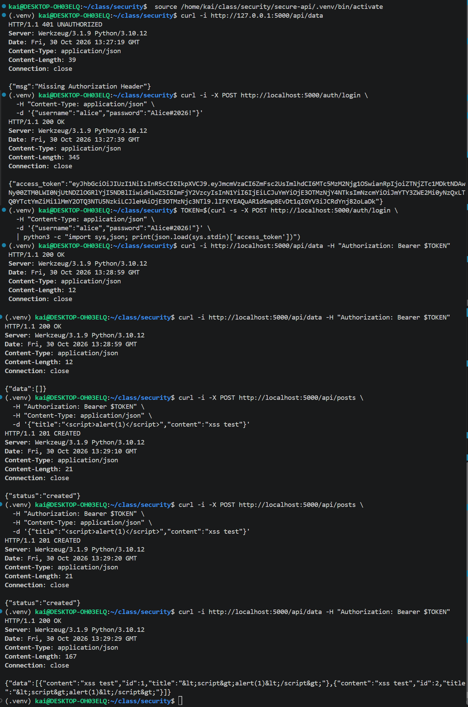
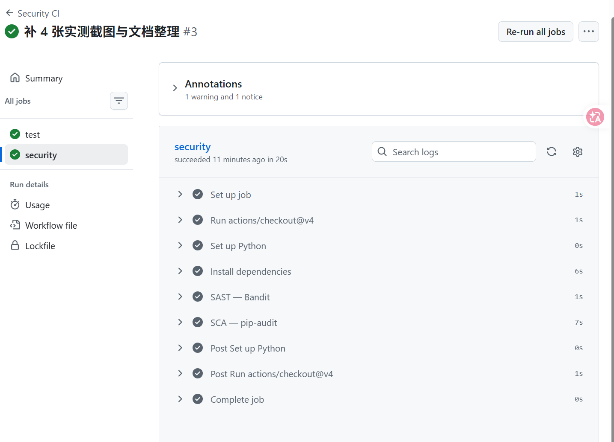

# secure-api —— 安全 REST API（作业第一部分）

基于 Flask 的安全 REST API，包含三个端点，落实三类安全防护：

| 防护点 | 技术手段 |
| --- | --- |
| 认证（1 分） | bcrypt 密码哈希（cost=12）+ JWT 无状态鉴权 |
| SQL 注入防护（0.5 分） | 全程参数化查询（`?` 占位符），无字符串拼接 |
| 存储型 XSS 防护（0.5 分） | 返回数据前用 `markupsafe.escape()` 做 HTML 实体编码 |

## 技术栈

- Python 3.10 / 3.11
- Flask 3.1.3
- flask-jwt-extended 4.6.0（JWT）
- bcrypt 4.1.3（密码哈希，cost=12）
- SQLite（Python 标准库 `sqlite3`）

## 目录结构

```
secure-api/
├── app.py                 # 主程序：/auth/login、/api/data、/api/posts
├── init_db.py             # 初始化数据库 + 内置测试用户 alice / Alice#2026!
├── test_app.py            # pytest 自动化测试（8 个用例）
├── requirements.txt
├── .gitignore
└── .github/workflows/
    └── ci.yml             # CI/CD 流水线（测试 + SAST + 依赖审计）
```

## 快速开始

```bash
cd secure-api
python3 -m venv .venv
source .venv/bin/activate          # Windows: .venv\Scripts\activate
pip install -r requirements.txt pytest
python init_db.py                  # 建库并写入测试用户 alice / Alice#2026!
python app.py                      # 启动于 http://localhost:5000
```

> 注意：若 `python3 -m venv` 报 `ensurepip is not available`，先安装
> `sudo apt install python3.10-venv`（或对应 Python 版本的 `python3.x-venv`）。

## 三个端点

| 方法 | 路径 | 说明 |
| --- | --- | --- |
| POST | `/auth/login` | 登录：bcrypt 校验密码，成功签发 JWT |
| GET | `/api/data` | JWT 保护：返回当前用户文章（title/content 已转义） |
| POST | `/api/posts` | JWT 保护：发布文章（参数化查询防 SQLi） |

## 本地测试

```bash
# 1. 无 token 访问 /api/data → 应返回 401
curl -s -o /dev/null -w "%{http_code}\n" http://localhost:5000/api/data

# 2. 登录获取 token
TOKEN=$(curl -s -X POST http://localhost:5000/auth/login \
  -H "Content-Type: application/json" \
  -d '{"username":"alice","password":"Alice#2026!"}' \
  | python -c "import sys,json; print(json.load(sys.stdin)['access_token'])")

# 3. 带 token 访问 /api/data → 应返回 200 + 空列表
curl -s http://localhost:5000/api/data -H "Authorization: Bearer $TOKEN"

# 4. 创建一条带 XSS payload 的 post
curl -s -X POST http://localhost:5000/api/posts \
  -H "Authorization: Bearer $TOKEN" \
  -H "Content-Type: application/json" \
  -d '{"title":"<script>alert(1)</script>","content":"xss test"}'

# 5. 再次读取 /api/data → title 应为转义后的 &lt;script&gt;
curl -s http://localhost:5000/api/data -H "Authorization: Bearer $TOKEN"
```



## 安全设计说明

- **认证**：`bcrypt.hashpw(..., gensalt(rounds=12))` 哈希存储密码；登录用 `checkpw`
  校验，成功签发 `create_access_token`，`@jwt_required()` 保护 `/api/data`、`/api/posts`；
  token 有效期 `JWT_ACCESS_TOKEN_EXPIRES = 900`（15 分钟）。
- **SQLi 防护**：所有 SQL 一律 `?` 占位符，例如登录处
  `SELECT ... WHERE username = ?`。若写成 `f"... WHERE username = '{username}'"`，
  `' OR '1'='1` 即可绕过登录（`test_login_sql_injection_blocked` 验证了这一点被拦截）。
- **XSS 防护**：文章内容原样入库，读取时 `markupsafe.escape()` 把 `<`、`>`、`&`、`'`、`"`
  转成 HTML 实体，`<script>alert(1)</script>` 读回为 `&lt;script&gt;...`。
- **其它**：用户不存在与密码错误统一返回 `invalid credentials` 防止枚举；JWT 密钥从环境
  变量 `JWT_SECRET_KEY` 读取（默认值仅本地开发用）；`app.run(debug=False)`。

## 自动化测试

```bash
pip install pytest
pytest -v          # 8 个用例全通过
```

覆盖：登录成功/密码错误、**SQLi 绕过被拦**、无 token 401、带 token 200 空列表、
未登录发帖 401、缺字段 400、**XSS 内容被转义**。

## CI/CD

仓库根目录 `.github/workflows/ci.yml`（`Security CI`），在 push / PR 到 `main` 时自动执行两个 Job：

1. **test**：Python 3.11，装依赖 → `pytest -v`（8 个用例）。
2. **security**：
   - SAST：`bandit -r . -x ./.venv --severity-level medium`（中危及以上导致 CI 失败）
   - SCA：`pip-audit -r requirements.txt`（对照 PyPI/OSV 检查依赖 CVE）

> 实测：`pip-audit` 曾检出 `Flask 3.0.3` 存在已知漏洞（PYSEC-2026-2151，会话缓存
> 敏感信息泄露，修复于 3.1.3），已升级为 `Flask==3.1.3` 后通过；`bandit` 在
> `--severity-level medium` 下 0 中危/高危。


